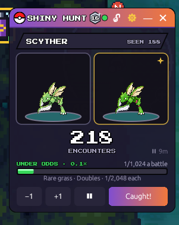

# ✨ Shiny Tracker (Poke Together Companion)

An always-on-top shiny hunting counter for **Pokémon Platinum Together**, now part of a small companion app with a Pokédex and a map.

  
  &nbsp;

## Download

Grab **Shiny Tracker.zip** from the [latest release](https://github.com/ZifuM/Shinytracker/releases/latest), unzip it and run **Shiny Tracker.exe**.
Windows 10/11, nothing else to install. It updates itself when a new version comes out.

## What it does

- **Counts every encounter** from the game's own log (or by reading the name plates on screen)
- **Shiny alert** with its own sound, plus your own sounds and an "alert song" if you like
- **Odds and luck**: how many hunters would have found it by now, and your chances from here
- **Stats**: time of day, sessions, week vs week, what you're running into
- **Shiny Dex, trophies, achievements and levels**, and share images for Discord
- **Multi-target hunts**, break reminders, backup and restore
- **Pokédex** *(experimental)*: every Pokémon in Platinum Together from the Platinum Together Wiki (plus stats from pokemondb.net), with evolutions, moves and where to catch them, including cut-outs of the map with the exact grass tiles marked
- **Map** *(experimental)*: Sinnoh drawn from your own game's map files, zoomable, every area outlined, and today's sparkly grass Pokémon from your game log

## Build it yourself

Install [Rust](https://rustup.rs), then run `build.bat`. It builds the app and makes `share\Shiny Tracker.zip`.

---

Fan-made and not affiliated with Nintendo, Game Freak or The Pokémon Company. It only reads the game's log and map files; it never changes them or the game's memory.

## Credits

The Team Planner's battle data (base stats, abilities, move details, held items and sample sets) comes from [Pokémon Showdown](https://github.com/smogon/pokemon-showdown)'s open data, and its damage calculator follows the Gen 4 steps of Smogon's [damage-calc](https://github.com/smogon/damage-calc). Both are MIT licensed.
